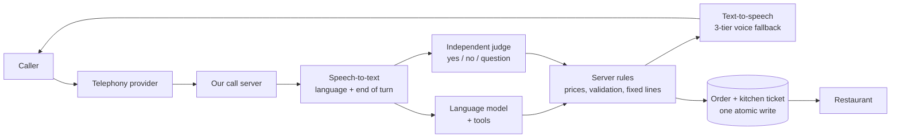

# AI Voice Agent: an AI phone receptionist for restaurants

> An AI agent that answers a restaurant's phone in Jordanian Arabic (and English), takes delivery, pickup, table and catering requests, and hands a confirmed order to the restaurant, while the **server**, not the language model, decides everything that cannot be undone.

## Honest status

| | |
|---|---|
| Stage | **Prototype / pre-launch.** Built by one person with AI assistance |
| Real phone calls | **None yet.** No phone number is connected (identity verification with the telephony provider is still pending) |
| Where it has been run | In a browser, in a telephone-line simulator, and with simulated callers that talk to it automatically |
| Real customers / restaurants | **None.** It has not been used by any real restaurant or caller |
| Deployed to a server | **No.** A container image was built and checked locally only |
| Legal review | Pending (data-protection and call-forwarding rules in Jordan); no privacy notice is published |

Nothing in this repository claims the agent is in production, customer-proven or validated on live calls, because it is not.

## What it does

- Answers calls as an automated assistant. It says it is automated in the first sentence, and the code rejects a greeting that does not say so
- Takes **delivery and pickup orders**, **table reservations** and **catering enquiries** in Jordanian Arabic or English, choosing the language per call
- **Reads the order back and waits for an explicit yes** before anything is sent
- Delivers the confirmed order to the restaurant as a kitchen ticket (messaging channel or webhook), with automatic retry
- Hands the call to a person when the caller asks for one, complains, or the system is unsure
- Adapts to each restaurant from **one configuration file** (menu, alternative names, delivery areas, opening hours, tone, voice). Adding a restaurant is data, not new code

## How it works

**Core principle:** the language model understands and talks; the server is the one that decides anything irreversible (saving an order, cancelling, ending the call, prices). Every "must not" rule is enforced in code, and the prompt only reduces how often the code has to say no.

## Technology

Python, Pipecat 1.11 (voice pipeline), Soniox (speech-to-text), OpenAI `gpt-6-luna` with reasoning switched off (conversation), a second provider's model as automatic fallback, OpenAI and Google voices for speech output with a third voice as last fallback, Telnyx (telephony), SQLite (orders), Docker.

## Documentation

| Document | What it covers |
|---|---|
| [How we worked](docs/how-we-worked.md) | The real story: what we researched, what we discovered, and what we changed because of it |
| [Design decisions](docs/design-decisions.md) | The important choices and the evidence behind each one |
| [Safety, privacy and compliance](docs/safety-and-compliance.md) | What the code guarantees, and what is still pending |
| [Voice and pronunciation](docs/voice-and-pronunciation.md) | How the voice problem was approached and how pronunciation is fixed word by word |
| [Testing and status](docs/testing-and-status.md) | What is measured, how, and what is not yet tested |

## What is in this repository

Documentation only. **The application source code is intentionally not included.** No credentials, API keys, phone numbers, restaurant data or customer data appear anywhere here.
